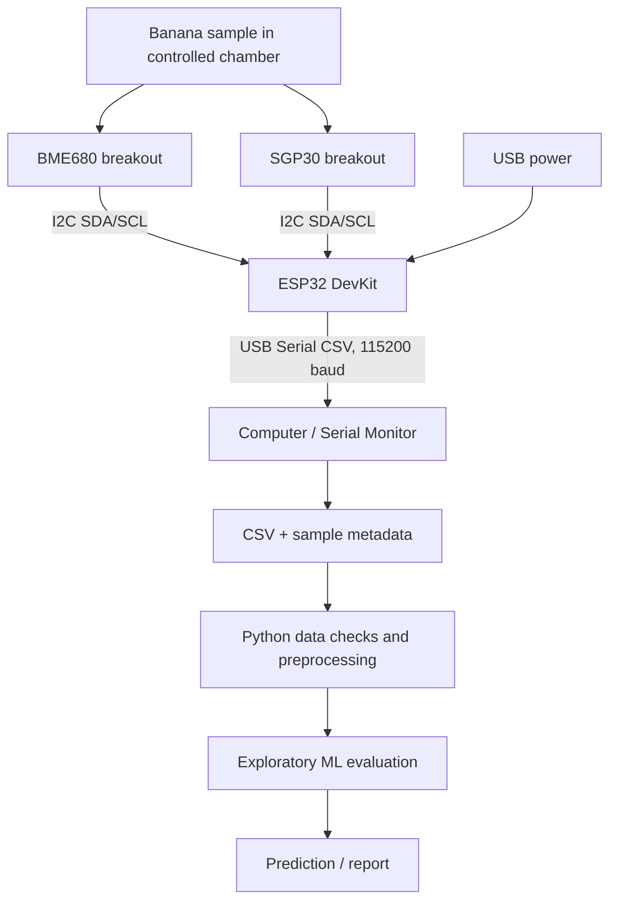

# Technical Design Document

## Architecture

## Module roles
- **Chamber:** helps keep measurements repeatable; it does not isolate individual gases.
- **BME680:** temperature, humidity, pressure, and gas resistance.
- **SGP30:** sensor-derived TVOC and equivalent CO2 (eCO2).
- **ESP32:** reads both sensors over I2C and prints CSV over USB serial.
- **Computer:** saves readings, associates trusted sample labels, checks data quality, and performs analysis.

## Interfaces
I2C uses GPIO 21 (SDA) and GPIO 22 (SCL). Serial output is 115200 baud. Firmware columns: `sample_no,elapsed_ms,bme_temp_c,bme_humidity_pct,bme_pressure_hpa,bme_gas_ohms,sgp_tvoc_ppb,sgp_eco2_ppm`.

## Workflow
Power and inspect wiring; record background readings; place one labelled sample; log for a consistent duration; record sample metadata; allow recovery/ventilation between samples; preserve raw logs.

## Verification
Test sensor initialization, CSV formatting, repeated baseline stability, sample repeatability, and model evaluation on independent samples. Sensor readings alone do not prove chemical identity or food safety.
